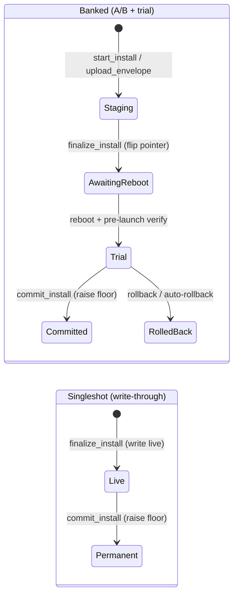
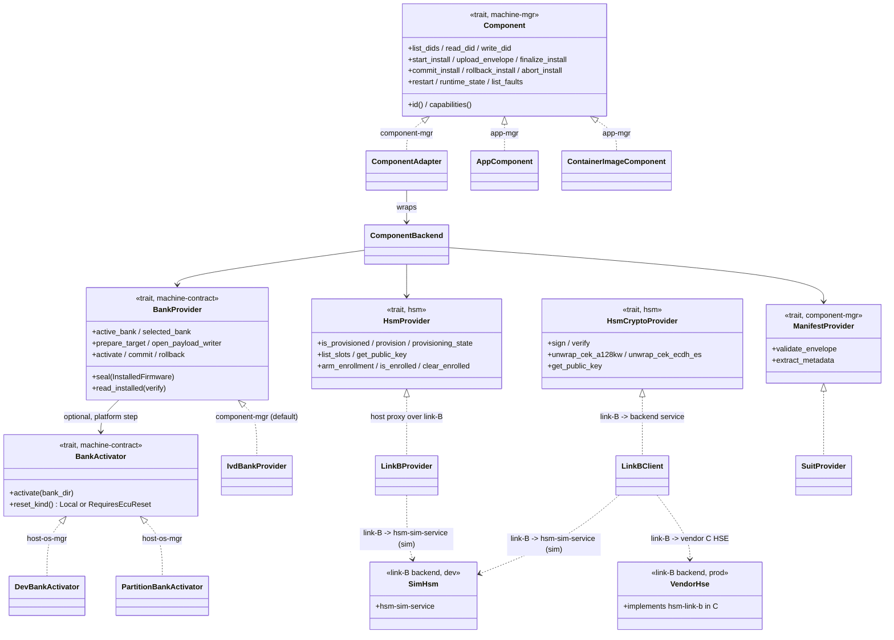
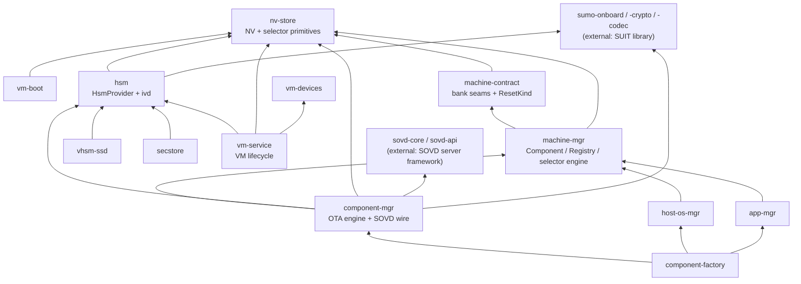
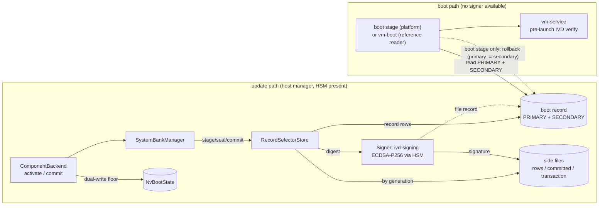
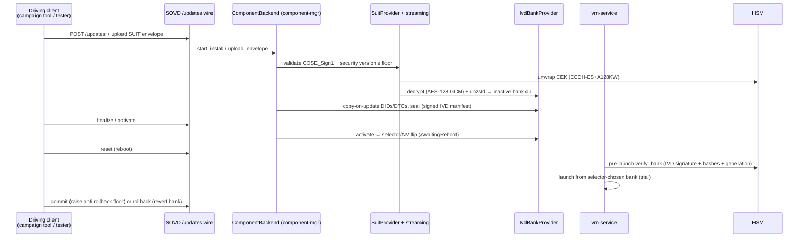

# Architecture: sumo-machine-manager

> Refreshed 2026-06-10. Earlier revisions documented a pre-rename architecture
> (`hypervisor-mgr`, `VmBackend`, `ComponentDiagBackend`, a 5-slot `BankSet`) that
> no longer exists. The code + each crate's `CLAUDE.md` are the canonical source
> for exact signatures; this doc is the contributor map.
>
> **Scope:** this document describes sumo-machine-manager as a freestanding
> project — its crates, seams, and the contracts it exposes to platform
> integrators. It does not describe any particular device integration or
> deployment; those live with the integrating system.

## Overview

Platform-agnostic machine manager for automotive ECUs. Manages A/B-bank software
updates across **multiple component kinds** (host-OS, RT core, VMs, container apps,
the HSM keystore) behind one update abstraction, with SUIT-manifest validation,
encrypted firmware, a signed node-level **boot selector**, and SOVD-compatible
diagnostics (UDS DIDs/DTCs + an OTA `/updates` wire).

Developed/tested on Linux (file-backed NV + QEMU); the `machine-mgr` trait layer +
per-crate `BlockDevice` / `HsmProvider` / `BankActivator` / `BankProvider` seams let
the same business logic run on other platforms (e.g. a QNX qvm hypervisor host) by
supplying concrete impls.

**Two-process model on a node:** `vm-service` (QEMU/qvm process lifecycle) +
`vm-sovd` (diagnostics + OTA engine). A platform integrator may also embed both in
a single host-manager binary that itself rides a bank slot (i.e. the host
manager is one of the components it updates).

**Division of responsibility (important):** the **real bootloader is C, owned by
the platform** — it reads the HSM + the raw boot vectors and starts the RT side,
then the host OS. This codebase only (1) does the A/B software update of each bank,
(2) writes the boot vectors, and (3) HSM-signs that data. The Rust `vm-boot` crate
is the **reference reader** of the boot-stage contract (a dev/sim stand-in), not the
boot authority. The raw
on-medium boot-vector format + the C-side verify are pending the platform spec;
until then the selector is a human-inspectable JSON store, with a real HSM signature.

## The update abstraction (lead with this)

The conceptual base is **"a thing that can be updated"** — `machine_mgr::Component`
(`crates/machine-mgr/src/component.rs`, 23 async methods, mostly `NotSupported`
defaults). Two structural shapes, discriminated at runtime via `Capabilities`:

| Shape | Lifecycle | Implementors |
|---|---|---|
| **Banked** — A/B + trial + commit/rollback | `start_install → upload_envelope → finalize_install (flip, reboot) → trial → commit_install OR auto-rollback` | `ComponentAdapter` (component-mgr, over `ComponentBackend`), `AppComponent` (app-mgr), an RT-core component |
| **Singleshot** — write-through, no rollback | `start_install → upload_envelope → finalize_install (write live) → commit_install (raise floor)` | the HSM keystore (a single-bank `ComponentBackend`), `ContainerImageComponent` (app-mgr) |



**Nearly everything is Banked/rollbackable** — even container images (bank the
manifest, keep both images in the registry). **The HSM keystore is the one genuinely
irreversible component** (secrets overwrite the old material; hardware security
engines have no rollback). The safety invariant that follows is a **transaction
property, not a per-component one**: *never mix rollbackable + irreversible
components in one upgrade* — a rollback of a mixed upgrade leaves the node undefined
(a VM reverts while the HSM keys are stuck forward). That guard belongs in the
offboard campaign/orchestration layer, not here. (A compile-time `Banked`/`Singleshot`
trait split was considered and **dropped** — it would type one outlier and not
enforce the real invariant.)

`MachineRegistry` (`crates/machine-mgr/src/machine.rs`) holds the components as
`Vec<Arc<dyn Component>>` + an id index and routes by `component_id`. Each component is
built by `component-factory::build_component` from a `ComponentSpec`.

### Seams (traits a platform integrator implements or swaps)



Integrators can add further impls outside this repo (e.g. a hardware-HSE
`HsmProvider`, platform device transports) — the seams above are the supported
extension points. The raw-partition `BankProvider` ships in-tree
(`PartitionBankProvider`); a consumer only declares its parts in the platform
profile.

Since v0.1.3 the four **synchronous** seams — `BankProvider`, `BankActivator`,
`Deactivator`, `ImageRecord` — plus `ResetKind` live in their own crate,
**`machine-contract`** (`nv-store` + `serde` and nothing else), so an
out-of-tree board manager can implement one without depending on SOVDd.
`machine-mgr` depends on that crate and re-exports every name from it, flat and
through the original module paths, so `machine_mgr::BankActivator` and friends
still resolve. `Component` stays in `machine-mgr` — it is async and speaks
`sovd-core` types throughout. The rule, the `ResetKind` decision and the
checklist for adding a contract trait are in
[`docs/reusable-component-convention.md`](docs/reusable-component-convention.md).

## Workspace crates

Three buckets (`docs/componentization.md` item 3d): **27 libraries** in `crates/`
(the consumable surface), **4 deployables** in `services/` (`vm-sovd`, `vhsm-ssd`,
`sumo-verify`, `slog2-drainer`), **8 host-side tools** in `tools/crates/`.
The core update/diagnostics path:

- **nv-store** (lib): sector-rotated NV regions (boot state, factory, FW meta, runtime
  DIDs) with CRC-32 + monotonic `write_seq`, over a pluggable `BlockDevice`. Also owns
  `selector` — the signed, generation-counted **boot-selector** primitives
  (`SelectorBlob`, `SelectorStore`, `Signer`) that a low crate like `vm-boot` can read
  without depending up.
- **vm-boot** (`crates/boot`, bin+lib): the reference reader of the boot-stage contract.
  Reports the **boot vector** (PRIMARY/SECONDARY) per component when present; else runs
  the NV boot-state path (per-slot trial counting + auto-rollback).
- **machine-contract** (lib): the out-of-tree implementer's surface — the four
  synchronous bank seams (`BankProvider`, `BankActivator`, `Deactivator`,
  `ImageRecord`) + `ResetKind`, over `nv-store` + `serde` and nothing else (a
  `cargo tree` guard in `scripts/feature-matrix.sh` keeps it that way).
  Extracted in v0.1.3 ahead of the per-board split of the platform manager; see
  `docs/reusable-component-convention.md`.
- **machine-mgr** (lib): the `Component` + `Machine`/`MachineRegistry` trait layer;
  `Capabilities`/`FlashCaps`; re-exports the `machine-contract` seams
  (unchanged import paths); `system_bank_state`
  (`SystemBankManager` + `BootSelector` — the node boot-authority engine, re-exporting
  the nv-store selector primitives). Platform-independent.
- **component-mgr** (lib only; the `vm-diagctl` CLI over it is `tools/crates/vm-diagctl`,
  and the SOVD/OTA **server** `vm-sovd` is its own crate in `services/`): the OTA engine + SOVD wire. `ComponentBackend` (the
  per-component state machine — DIDs, faults, the full install/flash lifecycle, modes);
  `ComponentAdapter` (exposes it as a `Component`); `install_router_diag`
  (`InstallRouterDiag` — routes a VM's install methods to its container-vs-VM router,
  delegates everything else to the engine); `bank_provider` (the `BankProvider` seam:
  `IvdBankProvider`); `dispatcher` (checks a SUIT envelope's target component NAME against
  the route's component); `suit_provider`, `manifest_provider`, `streaming`, `did`, `ota`.
  **`ComponentBackend` is wired directly into SOVD** — the old `ComponentDiagBackend`
  round-trip adapter was deleted (converged to one backend).
- **host-os-mgr** (lib): **activators only** — `DevBankActivator` (mount+copy) and
  `PartitionBankActivator` (raw partition write) impl `machine_mgr::BankActivator`. It no
  longer carries a `Component` impl of its own; the host OS is a `ComponentAdapter` like
  every other banked component.
- **app-mgr** (lib): `AppComponent` (Banked) + `ContainerImageComponent` (Singleshot —
  imports detached `#container-image` payloads into Docker/Podman/containerd).
  `ContainerImageComponent` and the container-image install route are behind the
  opt-in `container` feature (default OFF) — see `docs/features.md`.
- **component-factory** (lib): `build_component(ComponentSpec, FactoryDeps)` — builds the
  right backend + adapter per component kind (incl. the install router for app-capable VMs).
  It returns `Result<BuiltComponent, String>`: a component that cannot be built is absent
  from the registry, so it can be neither flashed nor diagnosed, and only the caller knows
  whether that is fatal for its deployment. `validate_specs(&[ComponentSpec], slots)` is the
  same verdicts a profile can get from its config parser *before* startup — plus the two
  cross-component rules no per-component check can see (one slot is one A/B selection; one
  partition is one device).
- **vm-mgr** (lib, was `vm-service`; the `vm-service` PROCESS that drives it is
  `tools/crates/vm-service`):
  QEMU/`qvm` lifecycle, per-bank VM config, the pre-launch
  IVD verify hook, IPC to vm-sovd. `runner/{qemu,qnx,dummy}`. Launches the VM **from the
  selector-chosen bank dir** (cwd=bank_dir) so the per-bank qvm.conf's relative
  `load kernel` resolves there (no `current` symlink).
- **vm-devices** (lib): host-side virtual CAN / health / time simulators (ivshmem vs QNX shm).
- **hsm** (lib): the HSM **contract** — `HsmProvider` (keystore/provisioning, 8 methods) +
  `HsmCryptoProvider` (re-exported from `hsm-contract`); `LinkBClient` + `serve_crypto` (the
  link-B bridge to an **out-of-process** backend — the sim `hsm-sim-service` in
  `tools/crates/hsm-sim-backend`, or a vendor C HSE implementing `hsm-link-b`, with the C
  vendor skeleton at `crates/hsm-link-b/reference/` and the conformance suite at
  `tools/crates/hsm-conformance`); `ivd` (per-bank IVD manifest sign/verify with the
  `ivd-signing` key — the same key that signs the boot selector). 11 mandatory `KeyRole`s.
  Contract-only — no in-process HSM lives here; see `docs/hsm-backend-architecture.md`.
- **vhsm-server** (lib, `crates/`) + **vhsm-ssd** (the daemon, `services/` — it keeps the
  package name, which is what `cargo install`, the device process and the CWT `aud` claim
  all address): host daemon terminating the guest `/dev/vhsm` v3 handle
  protocol over TCP on a private host bridge; identity = CWT/IAM handshake (source-IP pre-gate).
- **secstore** (lib): encrypted key-metadata persistence (`SecstoreEncryptor` +
  `SecstoreBackend`).

Support crates: **policy-eval** /
**policy-partition** / **policy-build** (guest IAM policy), **ca-bundle-build**,
**vm-wire**, **host-metrics** (OpenTelemetry/Prometheus host sensors — the library
supernova embeds; the Prometheus exporter process is
`tools/crates/host-metrics-exporter`),
**log-rotate**, **puller**.

Deployables in `services/`: **vm-sovd** (the SOVD/OTA server process),
**vhsm-ssd** (the vHSM daemon, above), **sumo-verify** (the launch gate — external
secure boot / the start script runs it per component, on the management path
SUIT/IVD verify), **slog2-drainer** (Tier-2 host: drains the QNX slog2 ring into
sealed disk segments).

### Crate composition (bottom-up)



External dependencies of note: the **SOVD server framework** (`sovd-core`'s
`DiagnosticBackend` trait + `sovd-api`'s router — `ComponentBackend` implements the
trait and is served by that router) and the **SUIT manifest library**
(`sumo-onboard`/`sumo-crypto`/`sumo-codec` for envelope validation, streaming
decrypt, decompression).

## Boot authority — the selector

**Who decides what.** An update must never leave the node unbootable, and the party that
decides whether an update stands must be the one able to judge its result. Three actors,
one responsibility each:

- **The orchestrator decides.** Every software update comes from sumo's orchestrator; it
  alone issues the commit or rollback verdict.
- **The node executes and observes.** It stages, seals, commits and rolls back on those
  verdicts, and records what it saw — how many trial boots it ran, how each transaction
  ended — in the boot vector's transaction header.
- **The boot stage restores the committed copy, and nothing else.** When the node fails to
  start, its one act is primary := secondary on the boot vector. It understands primary,
  secondary and generation, and nothing about the transaction.

Two counters, by design, with distinct roles. The boot stage's own boot counter is the
**safeguard** against bricking: it fires only when sumo never ran to settle the trial.
The header's `trial_boots` is **information**: how many trial boots the node actually
executed. A host-set trial boot limit is optional policy on top of that count and must sit
strictly below the boot stage's bound.

The store never leaves a header recorded above the primary generation (write order,
below). So a header above the primary on a committed vector can mean only one thing — the
boot stage acted — and `SystemBankManager::load` records it as resolved
`rolled_back` / `boot_stage`, keeping the count.

The goal: sumo stays authoritative over every update; the boot stage stays ignorant of
update semantics; and the count plus the recorded resolution of each transaction survive
the boot stage's action, which is what a future onboard orchestrator needs to tell "the
part that must deliver the verdict booted N times and never reported".

**Two kinds of rows.** The boot stage's record holds only the rows of the components it
routes (**record rows**), and stays minimal: nothing goes into it that the boot stage does
not need to boot, since every field there would have to be implemented in each port's
record. The rest — the **manager rows** (components whose bank the machine manager selects
after boot) and the transaction header — lives in sumo's side files, tied to the record by
generation. The mechanism is sumo's, the same for every port: a host implements only
`BootRecord` (`routes`, `read(copy)`, `activate`, `commit`, `rollback`) and builds its store
with `RecordSelectorStore::over(record, dir, signer)`. The reference `FileSelectorStore` is
that same adapter over a `FileBootRecord` that routes every component. A host runs both
executable contracts (feature `test-seams`): `contract::exercise_record(&record)` and
`contract::exercise(&store)`.

The node has one authenticated boot record, the **selector**, that supersedes the original
per-component NV boot state as the authority for "which bank each set boots from":

- `BootVector { generation: u64, entries: BTreeMap<String, ComponentEntry> }`
  (`nv-store::selector`) — the **boot vector**. Entries are keyed by **component id**; each
  carries the component's `bank` and the images sealed into that bank by part name
  (`ImageEntry { size, sha256 }`, possibly empty). Two copies via `SelectorStore`:
  **PRIMARY** (booted) and **SECONDARY** (rollback floor). A component is in trial iff its
  PRIMARY entry differs from its SECONDARY entry. One bank per component is structural: the
  map holds exactly one entry per id.

  **The store issues the generation and authenticates its contents; the manager adopts what
  the store returns.** `SystemBankManager` never computes a generation and never signs: it
  calls the store's verbs and keeps, in memory, exactly what they report. The contract is
  the same for every store — the reference file store, the in-memory test store, and a host
  store over its own boot-stage record (whose boot stage may issue generations from a
  hardware counter and bring its own rollback primitive) — and is executable:
  `nv_store::selector::contract::exercise(&store)` (feature `test-seams`) asserts it against
  any implementation.

  | Verb | Contract | Record adapter (`RecordSelectorStore`) | File record |
  |---|---|---|---|
  | `read_primary` / `read_secondary` | the authenticated copy, or `None` (absent or failed check) | the record's copy ∪ the manager rows at its generation (primary: `rows`, else `committed`; secondary: `committed`, else `rows` when the record is committed at that generation; else the newest, with a warning); the record wins a key collision | parse the file, `None` unless `is_valid` under its `Signer` |
  | `activate(entries, header)` | primary := entries at a generation the store issues, strictly above both copies; header recorded for it; returns the generation. A header write that fails after the primary landed is logged as header loss and still `Ok` | splits by `routes`; record first, then `rows` and `transaction` at the generation it returned | `max(primary, secondary) + 1`; writes `primary` |
  | `commit()` | secondary := primary (same generation); idempotent; no-op without a primary | record, then `committed` from `rows` | rewrites `secondary` from `primary` |
  | `rollback(header)` | primary := secondary; header recorded for the restored generation; returns it; `Err(NoTrial)` when there is nothing to restore | `NoTrial` checked first; `transaction`, then the record, then `rows` from `committed` | `primary` from `secondary` |
  | `read_transaction()` | the header and the generation it was recorded for | the `transaction` file, else the record's legacy header | the header embedded in a v0.1.14 primary |
  | `write_transaction(gen, header)` | rewrite the header for `gen`, neither copy touched | rewrites `transaction`; rows untouched | — |

  Two durability classes: the copies are **what boots** and sit under anti-rollback (only
  `activate` / `commit` / `rollback` move them); the header is **what the node observed
  about the transaction**, rewritten on every trial boot without touching either copy.
  The header is tied to the primary generation: a header whose recorded generation differs
  from the primary's is stale and is read as absent (`SystemBankManager::load` drops it with
  a warning) — except a header above the primary on a committed vector, which is the boot
  stage's rollback and is recorded (see **Who decides what**). The write order keeps that
  reading unambiguous: no failed write verb leaves a header above the primary.

  The adapter's side files, in its `dir`, are signed
  `SelectorBlob { generation, entries, transaction, sha256, signature, selectors }`s written
  tmp + fsync + rename: `rows` (manager rows at the record's primary generation), `committed`
  (manager rows at its secondary generation) and `transaction` (**empty** entries at the
  primary generation it belongs to, carrying the header). The reference
  `FileSelectorStore::new(dir, signer)` keeps its record in the same directory under the same
  signer — `primary` and `secondary` (copies, no header) — so its `rows` and `committed`
  carry empty entries, and `primary` / `secondary` / `transaction` are byte-identical to the
  earlier three-file store. A primary written by v0.1.14 still carries the header embedded in
  its own blob; it is read as the header until the next header write replaces it with the
  `transaction` file.

  ```json
  {
    "generation": 3,
    "entries": {
      "vm1": {
        "bank": "B",
        "images": {
          "kernel": { "size": 4096, "sha256": "abab…ab" }
        }
      }
    },
    "sha256": "…",
    "signature": "…"
  }
  ```

  Canonical bytes under `sha256` (all integers little-endian): `u64 generation`, then per
  entry in ascending id order `u16 id.len()`, id bytes, `u8 bank` (A=0, B=1),
  `u16 images.len()`, then per image in ascending name order `u16 name.len()`, name bytes,
  `u64 size`, 32 bytes sha256; then, only when a transaction header is present (the
  `transaction` file, or a v0.1.14 primary), `u8 0x01`,
  16 bytes `armed_boot_id`, `u8 trial_boots`, 16 bytes `counted_boot_id`, `u8 resolution`
  (0 none, 1 committed, 2 rolled_back), `u8 reason` (0 verdict, 1 trial_boot_limit,
  2 boot_stage; 0 with no resolution). A blob without a header digests exactly as before.
  The signature is over `sha256`.

  The **transaction header** (`Transaction`) is kept apart from both copies, recorded for
  the primary generation: `armed_boot_id` (node boot id at `seal`,
  reduced to the first 16 bytes of its SHA-256; zero = unknown), `trial_boots` (distinct
  node boots counted while armed without a verdict), `counted_boot_id` (the last boot
  counted; zero = none) and `resolution` (`{outcome: committed|rolled_back, reason:
  verdict|trial_boot_limit|boot_stage}`). It is meaningful only while the node is in trial
  (PRIMARY entries differ from the backup's) or when it records a resolution; readers gate
  on that.
  `seal` activates with a fresh header; `commit` moves the backup only, so the header
  stays; `rollback` restores the backup and records the header with its resolution set;
  counting a trial boot rewrites the header only. A rollback on a node that is not in trial
  writes nothing and keeps the recorded resolution, so a later verdict rollback does not
  overwrite an earlier reason.

  The optional **legacy slot map** `selectors: { "<slot>": { "bank": "A" } }` is emitted
  only by a `FileSelectorStore` built `with_legacy_slot_map(component id → slot)`, for a
  boot stage that still reads the previous shape; it is outside the digest, never read
  back, and goes away when no deployed boot stage needs it.
- **Two counters.** The node counts trial boots in the header per distinct boot id (the
  arming boot and an already-counted boot count nothing), so a process restart within one
  boot counts nothing. On top of that count a host may set
  `NodeCoordinator::with_trial_boot_limit(Some(n))` (`None`, the default, disables it;
  sumo has no default value): after `n` counted boots without a verdict the node rolls the
  whole node back by itself — the same path a rollback verdict takes, differing only in the
  recorded reason (`trial_boot_limit`): the boot vector first (the authority), then each
  component that was in trial rolls back its own NV. The node never commits by itself. The
  host sets `n` below its boot stage's own bound, so the node, not the boot stage, settles
  the trial; the boot stage's counter stays the safeguard for when sumo never runs.

  Host contract: call `MachineRegistry::observe_node_boot(&coord)` once after the store is
  loaded and before serving, with the coordinator carrying the current node boot id. A
  failed count or a failed boot-vector rollback is logged and retried on the next boot;
  per-component rollback failures after the vector moved are returned in
  `NodeBootOutcome::errors`.

  Seed: call `MachineRegistry::seed_selector` when `SystemBankManager::is_empty()` or
  `!missing_entries(ids).is_empty()`. A vector holding record rows but no manager rows (the
  first start over a record, or a double fault) would otherwise leave those components
  without an entry, and they would never launch. On a non-empty vector the seed adds only
  the missing ids, at their NV floor with no images, then commits and re-seals the NV trials
  among them; existing entries and their sealed images are untouched. While a trial stands
  it writes nothing — the commit would settle the trial without a verdict — and the missing
  ids are seeded after the verdict.
- **Verdict membership is the structural trial set.** The node verdict skips a component
  whose `banks()` reports it out of trial: with a boot vector, its PRIMARY entry equals the
  backup's; without one, the NV committed flag.
- **Signed by the HSM** with `ivd-signing` (a `Signer` impl the host-manager process,
  where the HSM is reachable, passes to `FileSelectorStore::new`; the store verifies every
  blob it reads). Previously a `StubSigner` (empty signature) — now real ECDSA-P256. The
  store is the file-backed JSON `FileSelectorStore` (pretty, one key per line) until a host
  plugs its record in with `RecordSelectorStore::over`; the record authenticates by its own
  means, the side files with the signer passed to `over`.
- `vm-boot` is the reference reader: it reports each PRIMARY entry's bank and trial state
  and writes nothing; it ignores the transaction header. It opens the file store with a
  `StubSigner` today (it has never verified); a verifying reader passes a real `Signer`. The boot vector carries no slot,
  so it cannot drive the per-slot NV trial counter; the NV path (no boot vector) keeps its
  trial counting + auto-rollback, and the boot-vector path counts in the header instead
  (`observe_node_boot`, above).
- **Sumo has no opinion on component names or slot numbers** — both come from the host
  profile.
- **The store can fail.** `SelectorStore` write verbs return `Result`, and an `Err` means
  the primary is unchanged; `SystemBankManager`'s `seal` / `commit` / `rollback` /
  `observe_node_boot` persist first and move their in-memory view only on success, so
  memory never runs ahead of storage. `activate` writes the vector before the header; if
  the header write then fails, the vector is the truth and the store logs the header loss:
  trial-boot counting degrades (the previous header sits below the primary, reads as
  absent, so that trial counts nothing), nothing else. `rollback` writes the header before
  the vector, so a failed vector write leaves the trial in place and a stale header below
  it. A header above the primary is therefore never a failed write: on a committed vector
  `load` records it as the boot stage's rollback (written first, adopted after; a failed
  record adopts no header), anywhere else it is dropped. A failed seal fails `activate`,
  which leaves NV unarmed. A failed commit or rollback verdict is reported to the orchestrator;
  NV is written before the boot vector, so NV is then one step ahead. A commit is safe to
  retry (NV folds an already-committed set into success); a rollback verdict retry is
  still refused by NV as not-in-trial (the provider still writes NV first). With a trial
  boot limit set, the gap closes on its own: the vector is still in trial, so later boots
  count and the bail-out rolls the vector back (the per-component NV rollback then reports
  not-in-trial in `NodeBootOutcome::errors`). Without a limit it closes only once the write
  order changes.

  The record adapter adds its own rules, record first throughout. `activate`: a failed
  `rows` write rolls the record back when it was not in trial before and returns `Err`; with
  a trial standing it returns `Err` and leaves the record alone (a rollback would discard
  the trial; the retry heals). `commit`: a failed `committed` write is `Err` after the
  record committed; the retry is idempotent, and until then the rows at the committed
  generation read as committed. `rollback`: `NoTrial` is checked before any write; the
  header goes first, the record next, `rows` last (a failed `rows` write is logged, and
  reads follow `committed`). Manager rows are never written empty as a fallback, except over
  a record that routes everything. Attribution: a header recorded for a generation other
  than the record's primary is read only when manager rows exist at its generation, so a
  header left by an older layout is dropped, never read as the boot stage's rollback.
- `BankSet` is a bare `pub struct BankSet(pub u8)` newtype — a slot *number*, nothing more.
  The library names no slot: a component's slot comes from its spec (`slot: N`, written by
  the platform profile), and what a slot holds is that profile's decision (a spec that still
  carries a `bank_set:` name is refused at load — "slot names were retired in v0.1.2 — set
  `slot: N`"). The slot *count* is runtime — `slot_count()`, derived from the NV device size
  (default 16, `MAX_SLOTS=64`). The old reference layout survives only as test fixtures
  (`nv_store::slots::{HSM, BOOTLOADER, OS, RT, VM1, VM2}`, behind `test-seams`).



The `BankProvider` seam (`component_mgr::bank_provider`) routes *every* bank touch (stage /
activate / commit / rollback / selected-bank) through one trait per kind, so the boot
selector + NV stay consistent. `IvdBankProvider` is the default (signed CBOR manifest in
the bank dir + NV boot-state); `PartitionBankProvider` is the shipped raw-partition
provider — one raw A/B partition pair per part, the parts declared by the platform
profile (`parts:` on the component spec) — and plugs in at the same seam.

## OTA update flow (SOVD `/updates` wire)

Production OTA is SUIT envelopes driven over the SOVD **`/updates`** wire (the older
`/files` + `/flash/transfer` endpoints are retired). Per component, the driving client
runs upload envelope → finalize → activate → commit/rollback. Privileged writes are
authorized by the JWT bearer token at the sovd-api layer — the legacy UDS
session/security (seed/key) preamble is retired.



The engine steps (`ComponentBackend` + `ota.rs`):

1. **Upload + validate**: `suit_provider` checks the COSE_Sign1 signature against the
   provisioning authority, the security version against the per-bank anti-rollback floor
   (`min_security_ver`), and `streaming` decrypts (AES-128-GCM + ECDH-ES+A128KW per-device)
   + decompresses (zstd) payloads into the target (inactive) bank: a file-backed bank
   takes one file per payload in the bank dir; a raw-partition bank streams each payload
   straight to that part's A/B device. Multi-payload = one payload per declared part:
   VMs carry `#kernel` + `#firmware` (rootfs) + `#config` + partitions; a raw-partition
   bank carries one per `parts:` entry; the HSM carries `["hsm","keys"]`. Fail-closed: a
   manifest naming an undeclared part is rejected (415) at manifest time, never staged.
2. **Copy-on-update**: runtime DIDs/DTCs are cloned active→target bank before write.
3. **Finalize**: dual-bank flips the boot pointer (via the selector / NV) and needs a
   reboot (`AwaitingReboot`); single-bank (HSM) writes live and is immediately `Activated`.
4. **Reboot + verify**: `vm-service`'s pre-launch hook runs `hsm::ivd::verify_bank` (HSM
   signature on `ivd-manifest.cbor` + per-file hashes + generation floor) on the
   selector-chosen bank before launching.
5. **Commit / rollback**: commit raises the security floor + marks permanent; rollback
   reverts to the previous bank (Banked only — the HSM rejects rollback).

`FlashState` (sovd-core) is the 13-state dual-bank machine; single-bank collapses to
`… → Activated → Committed`. The committed bank's signed identity is exposed as the
vendor data param **`x-ota-installed-manifest`** (files+sha inventory + IVD identity +
signature for re-verification), and each component's update-mode as
**`x-ota-update-mode`** (`{update_mode: banked|singleshot, supports_rollback, dual_bank,
reset_kind}`, readable even pre-flash). Both are served from component-mgr's `read_data` hook
over the SOVD server's generic vendor-parameter wire — **all `x-*` vendor surface
is owned by this codebase**, keeping the SOVD server layer itself vendor-free.
The node-level `x-update-state` (alias `x-ota-update-state`) also reports, per component,
what each bank holds as `banks` (active / inactive bank with per-image size + SHA-256 from
the installed manifests, plus `in_trial`), so an orchestrator can compare the inactive bank
with its intent and download only what differs.
The installed manifest also records `install_boot_id`, the node boot id current when the
bank was sealed. It is covered by the manifest signature; `IVD_MANIFEST_VERSION` is
unchanged because the key is optional, and a manifest sealed before it existed reads as
unknown. `banks` reports it per bank and derives `pending_reset` from it: a component that
needs a node reset, whose active bank was sealed in the boot still running, still waits for
that reset.

### Node update transaction

One update transaction at a time per ECU, coordinated by `NodeCoordinator`
(`machine-mgr::node_update`). Its readers derive from facts, not stored intent: each
component's adapter registers its bank report (`in_trial`, `pending_reset`) with the
coordinator, and the node answers `rebooted_since_arming` — a node fact, whatever the
reset kind — from the boot vector's transaction header (`with_system_bank`: the boot id
recorded at seal against the current one). Without a boot vector the coordinator falls
back to the armed boot id in the NV update session, which the adapters register; with
neither it is unknown. Two gates refuse a new flash (409):

- **Pending reset**: any component is `pending_reset` (its install needs a node reset that
  has not happened yet). That list is `reboot_owed` on the wire, and the phase is
  `RebootPending`.
- **Trial after the reboot**: any component is `in_trial` and the node has rebooted since
  arming (`rebooted_since_arming == true`): the trial awaits its verdict. Before that
  reboot (`false` or unknown) an in-trial component is an armed sibling of the same step,
  so a new flash joins — one step, one reboot, one verdict, for Local-reset components too.

Otherwise a new flash opens the in-memory `Staging` set or joins it. There is no session
id. The phase is `Trial` while a component is in trial and none is pending. The NV
reboot-owed record (`NvUpdateSession`) is still written at arming and cleared at the
verdict; only its armed boot id is read, by the fallback above. It goes away in a later
change.

## VM launch (vm-service)

`vm-service` resolves the bank from the selector-set `bank` enum (never a `current`
symlink — that's retired), exposes the bank's `rootfs.img` + partitions as devb-loopback
device nodes (`/dev/qvmdisk-vmN0`, …), runs the IVD verify gate, then launches `qvm @<bank
dir>/qvm.conf` **with cwd = the bank dir** so the conf's relative `load kernel` resolves to
that bank. The qvm.conf is **host-integration config** (NICs, disks, MMIO) and lives with
the deployment, not the guest build (which ships only a reference example).

## State management

Per-component NV (sector-rotated, CRC-protected, power-loss-safe): `NvBootState`
(`[BankBootState; MAX_SLOTS]` — active_bank/committed/boot_count per set, the first
`slot_count()` addressable), `NvFactory`
(serial/VIN/HW ids, write-once), `NvFwMeta` (per set+bank: fw identity, security version,
image hash, `min_security_ver` floor), `NvRuntime` (writable per-bank DIDs/DTCs). Boot
authority sits *above* this in the signed selector. Live SOVD/upload state is in-memory
under a per-component mutex.

DID resolution priority: Runtime (writable, per-bank) > FW-meta / signed IVD manifest
(software identity F187–F19E) > Factory (hardware identity) > Dynamic (computed from boot
state + health). Identity DIDs are served from the *signed* manifest overlay and gate on a
committed manifest (list↔read agree).

## Key design patterns

- **Generic over `BlockDevice`** — `NvStore<D>`/`BootManager<D>` parameterized over storage
  (MemBlockDevice tests, FileBlockDevice dev, raw block prod).
- **Sector rotation** — each NV region rotates 2–8 sectors; write to lowest `write_seq`,
  read highest valid CRC. Wear-leveling + atomic + corruption recovery. `NvRecord` =
  magic + write_seq + manual LE payload + CRC.
- **One backend, not two** — `ComponentBackend` is the single data/OTA authority wired
  directly into SOVD. App-capable VMs keep a *narrow* `InstallRouterDiag` (routes only
  install/flash to the container-vs-VM router, delegates the rest to the engine). The old
  `ComponentDiagBackend` round-trip adapter is gone.
- **BankProvider seam** — every bank touch goes through one trait per kind; the selector
  is the authority, NV is the floor.
- **Boot selector is HSM-signed** — `ivd-signing` signs the selector digest in the
  host-manager process (HSM present); the (future C) bootloader verifies at boot (HSM
  present on real silicon).
- **qvm.conf is host-integration** — lives with the deployment; relative `load kernel`
  + vm-service cwd=bank_dir; no `current` symlink.
- **Anti-rollback floor** — `min_security_ver` raised only on commit (not install), so
  trial can roll back; once raised, lower security versions are permanently rejected.
- **Copy-on-update** — runtime DIDs/DTCs cloned to the target bank before OTA write.
- **Encrypted key metadata (secstore)** — separates "where bytes live" from "how they're
  encrypted"; `vhsm-ssd` is the single atomic writer; production swaps in a hardware-backed
  encryptor.
- **Independent bank sets** — sets have independent A/B state, enabling staged rollouts.
  But an upgrade must not mix rollbackable + irreversible (HSM) — see the update
  abstraction above.

## Build & test

```bash
cargo build
cargo test              # 425+ tests
cargo run -p component-mgr --example build_hsm_keys   # generate SUIT artifacts
./example/run.sh --fresh    # start the SOVD server
```

Unit tests use `MemBlockDevice` (zero I/O). SOVD integration tests drive the real router
via `tower::ServiceExt::oneshot()` (no live server) covering session/security/upload/
prepare/execute/commit + the install-router + the vendor data params. HSM/vhsm-ssd tests
cover sign/verify/encrypt/derive + handle/policy + SUIT key provisioning.

## Recent architecture changes (2026-06)

- **Boot-selector authority flip** — the signed `SelectorBlob` (not per-component NV) is
  the boot authority; `vm-boot` reads it; global trial/rollback.
- **HSM-signed selector** — `StubSigner` → a real HSM-backed `Signer` (ivd-signing,
  ECDSA-P256).
- **Converged to one diagnostics backend** — deleted `ComponentDiagBackend`; wired
  `ComponentBackend` directly; app-capable VMs use the narrow `InstallRouterDiag`.
- **`BankSet` redo** — a bare slot number; the named slots were retired in v0.1.2 (a
  component's slot comes from its spec, written by the platform profile). The slot *count*
  is runtime since 2026-09-23 (device-derived, max 32; 64 since 2026-09-28).
- **`current` symlink retired** (per-VM) — bank-relative `load kernel` + vm-service
  cwd=bank_dir. (`mmgr/current`, the host manager's own self-update bank pointer, stays.)
- **qvm.conf moved to the deployment** as host-integration config (examples in the
  guest repos).
- **Vendor data params** `x-ota-installed-manifest` (signed IVD identity) +
  `x-ota-update-mode` (rollback-capability, for an offboard twin to sync).
- **Dropped** the `Banked`/`Singleshot` compile-time trait split (the real risk is
  upgrade composition, enforced offboard).
